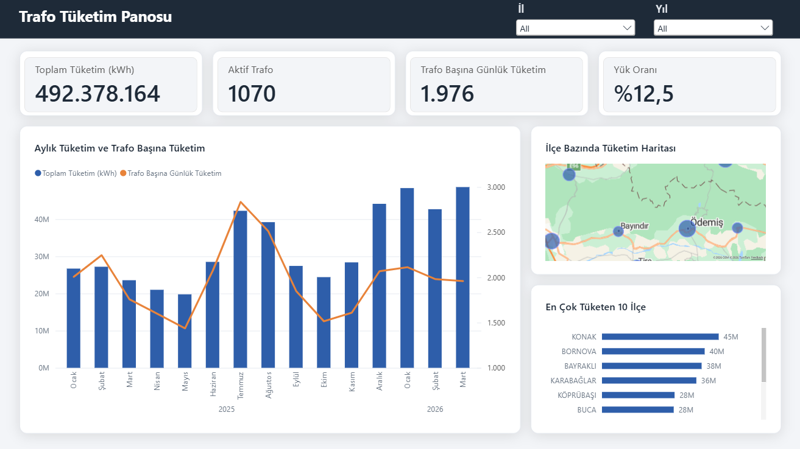

# Trafo Bazlı Günlük Elektrik Tüketimi Tahmini

**Grid Up Datathon 2026 · Private 0,99687 · Public 1,00005 · 12. sıra · bireysel katılım**

Gdz Elektrik ve Adm Elektrik iş birliğiyle düzenlenen yarışmanın çözümü.
Dağıtım şebekesindeki her trafonun Nisan-Temmuz 2026 arasındaki her günkü
aktif tüketimi (kWh) tahmin ediliyor. Eldeki geçmiş Ocak 2025 ile Mart 2026
arası, metrik RMSLE.

Çözümün tamamı tek bir notebook'ta ve baştan sona koşuyor:
[`notebooks/gridup_cozum.ipynb`](notebooks/gridup_cozum.ipynb)

## Yaklaşım

Tahmin tek bir modelin çıktısı değil, dört bileşenin toplamı.

**Günlük endeks:** Bütün trafoları aynı gün aynı yönde iten mevsim ve takvim
etkisi. Ridge ile hava ve takvimden kestiriliyor, güç sınıfına göre katmanlı.
Doğrusal model bilinçli bir seçim: tahmin penceresindeki endeks eğitimde
görülenin katlarına çıkabiliyor ve ağaç en yüksek yaprağında sıkışır.

**Trafo seviyesi:** Dört kademeli grup önceliği, tahmin ufkuyla büyüyen
bayatlık büzülmesi, ölü trafolar için uyanma olasılıklı muafiyet, trafo bazlı
mevsim genliği, ve ilçe çarpı güç sınıfı düzeyinde profil, gün deseni ile
tatil düzeltmesi.

**Cross-sectional model:** Test satırlarının beşte biri eğitim verisinde hiç
görünmeyen trafolara ait ve naif hatanın üçte ikisini taşıyor. O blok için
trafo başına bir satırlık ayrı bir model kuruluyor: LightGBM ve CatBoost,
üçer tohum, dokuz özellik.

**Düzeltme yönleri:** Her biri taban formülünün bıraktığı belirli bir artığı
hedefleyen vektörler. Katsayıları elle seçilmiyor; üç zaman katından, ölçekli
cezalı kapalı formla çözülüyor. Ceza katsayısı da kat dışı doğrulama hatasına
bakılarak ızgaradan seçiliyor. Bir yön ancak üç katın üçünde de aynı işareti
verirse nihai tahmine giriyor.

## Sonuç

Ölçüm penceresinde, gerçek tahmin ufkuyla aynı uzunlukta (122 gün):

| Adım | RMSLE |
|---|---|
| Naif taban | 1,0867 |
| Seviye ve endeks formülü | 0,9240 |
| Cross-validation katsayılarıyla düzeltilmiş | 0,9179 |

Kazancın büyük kısmı formülden geliyor. Yirmi üç düzeltme yönü kuruluyor,
dokuzu işaret kapısından geçiyor; kat dışı kazanç +0,00621 RMSLE ve ölçülen
gürültü bandının çok üstünde.

## Nasıl koşulur

```bash
pip install -r requirements.txt
jupyter notebook notebooks/gridup_cozum.ipynb
```

Yarışma verisi (`train.csv`, `test.csv`) repoda yok, Kaggle'dan indirilip
`data/` altına konulmalı. Hava ve takvim tabloları repoda. Notebook üç ortamda
da çalışır (Kaggle, Colab, yerel) ve veri yolunu kendisi bulur. Tam koşum dört
çekirdekli bir dizüstünde yaklaşık kırk dakika sürüyor, zirve bellek 2,8 GB,
çıktısı `submission.csv`.

## Dış veri

| Kaynak | Ne sağlıyor |
|---|---|
| [Open-Meteo](https://open-meteo.com/) | Sıcaklık, ısıtma ve soğutma derece günü, ışınım, nem, bulut, rüzgar, yağış |
| [holidays](https://pypi.org/project/holidays/) | Resmi ve dini tatiller, arife, köprü günleri, bayram yapısı, okul dönemi |

EPİAŞ Şeffaflık verileri bilerek kullanılmadı: o seriler tahmin dönemine ait
gerçekleşmiş sistem tüketimini içeriyor ve bir dağıtım şirketi Nisan tahminini
yaparken Temmuz'un gerçekleşenini bilemez.

## Power BI panosu

Aynı veri yarışmadan sonra SQL Server'da dört tabloya normalize edildi ve
Power BI'da üç sayfalık bir şebeke izleme panosuna dönüştürüldü: genel bakış,
anomali ve veri kalitesi, şebeke ve kapasite. Sayfa görüntüleri, veri modeli,
DAX ölçüleri ve tasarım dosyaları [`powerbi/`](powerbi/) altında.

[](powerbi/README.md)

## Dizin yapısı

```
notebooks/gridup_cozum.ipynb    çözümün tamamı, baştan sona koşar
data/notebook_dis_veri/         günlük hava ve takvim tabloları
requirements.txt                kullanılan sürümler
powerbi/                        Power BI panosu: görüntüler, tema, ölçüler
```
