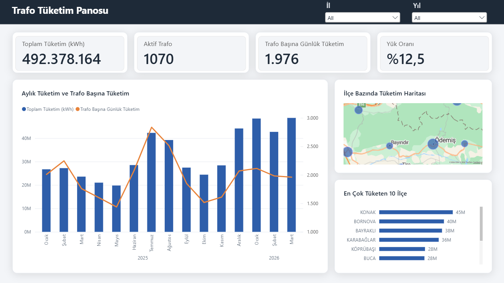
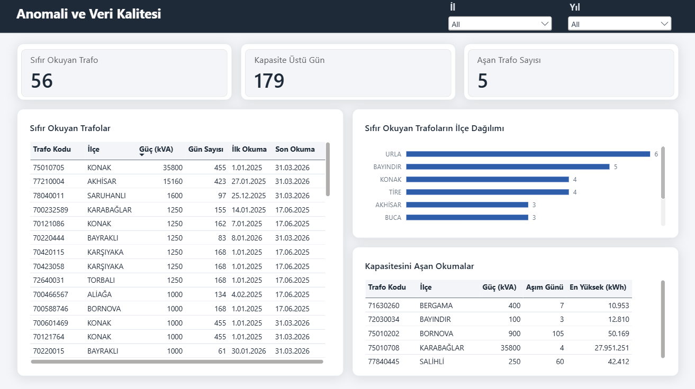
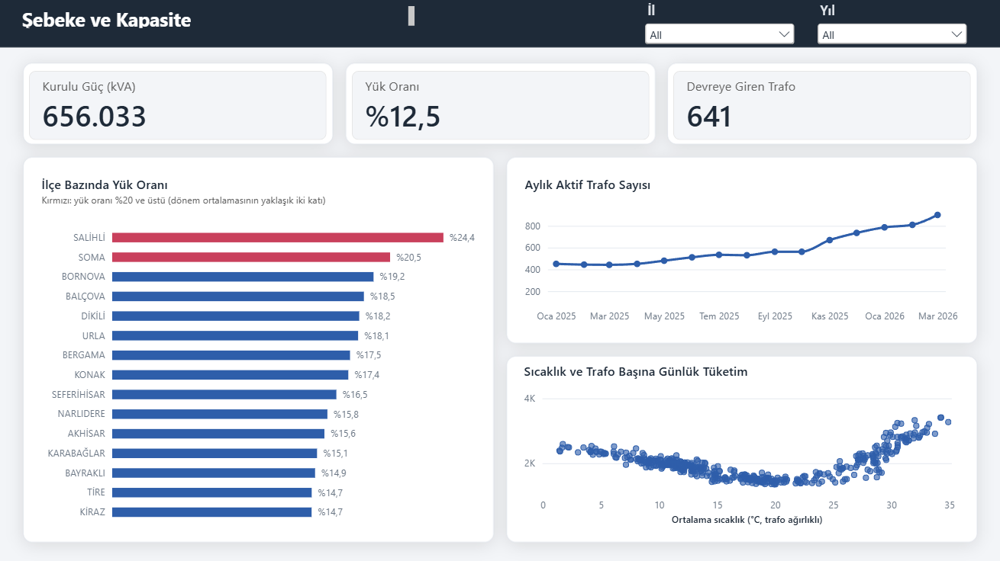

# Trafo Tüketim Panosu (Power BI)

Grid Up Datathon 2026 verisinin SQL Server'da normalize edilip Power BI'da
üç sayfalık bir şebeke izleme panosuna dönüştürülmüş hâli. Yarışmadaki
tahmin problemi burada ters çevriliyor: tahmin değil, eldeki 15 aylık
tüketim verisinin ne söylediği.

Veri: 1.076 trafo, 47 ilçe (İzmir ve Manisa), Ocak 2025 ile Mart 2026 arası
günlük aktif tüketim. Yarışma verisi repoda yer almıyor, `.pbix` dosyası da
bu nedenle paylaşılmıyor. Aşağıdaki görüntüler panonun son hâli.

## Sayfa 1: Genel Bakış



Dört gösterge, aylık zaman serisi, ilçe haritası ve ilk 10 ilçe. Zaman
serisinde iki eksen var: sütunlar toplam tüketimi, çizgi trafo başına
günlük tüketimi gösteriyor. Toplam 15 ayda ikiye katlanırken trafo başına
tüketim aynı seviyede kalıyor; artış talepten değil, yıl içinde devreye
giren 641 trafodan geliyor. Temmuz ve Ağustos zirvesi klima yükü.

## Sayfa 2: Anomali ve Veri Kalitesi



Üç anomali tipi, her biri fiziksel bir eşiğe dayanıyor:

| Tip | Kural | Bulgu |
|---|---|---|
| Sessiz sayaç | Dönem toplamı sıfır, en az 7 gün veri | 56 trafo. Çoğunun son okuması aynı gün: 17 Haziran 2025. Tekil arıza değil, sistemsel bir kesinti deseni |
| Kapasite aşımı | Günlük kWh > kVA × 24 | 179 gün, yalnızca 5 trafoda. Bornova'daki trafo 105 gün sürekli aşıyor |
| Uç değer | Tek günlük en yüksek okuma | Karabağlar'da 35.800 kVA'lık trafo tek günde 27,9 milyon kWh: kapasitesinin 32 katı, fiziksel olarak mümkün değil. Veri hatası olarak sınıflandı |

Sıfır okuyanların ilçe dağılımı düz; kümelenme coğrafyada değil tarihte.

## Sayfa 3: Şebeke ve Kapasite



Hatalı okumalı trafo bu sayfadan sayfa düzeyinde çıkarıldı. Çıkarılmasaydı
Karabağlar Temmuz'da yüzde 74 yük oranıyla acil yatırım gerektiriyor
görünecekti; gerçek değeri yüzde 15.

- İlçe bazında yük oranı yüzde 13 ile 24 arasında. Yüzde 20 üstü kırmızı
  (dönem ortalamasının yaklaşık iki katı, veriden türetilmiş bir eşik).
- Aktif trafo sayısı 443'ten 901'e; Kasım 2025'te toplu devreye alma.
- Sıcaklık ve trafo başına tüketim U eğrisi: dip 20 derece civarı,
  soğutma tarafı ısıtma tarafından dik.

## Veri modeli

Kar tanesi şema. Olgu tablosu `tuketim`, boyutlar `trafo` ve `gun`;
`bolge` normalize kaldığı için `trafo` üzerinden bağlanıyor.

```
gun (Tarih)  1 ─── * tuketim (trafo_id, Tarih, kWh)  * ─── 1 trafo (Trafo Kodu, Güç kVA)  * ─── 1 bolge (İl, Bölge, İlçe, Enlem, Boylam)
```

- `gun` tarih tablosu olarak işaretli; `Ay Adı` ay numarasına göre sıralı.
- Anahtar sütunlar rapor görünümünde gizli, `Summarize by: None`.
- İlçe koordinatları Open-Meteo geocoding ve OpenStreetMap'ten
  (`ilce_koordinat.csv`), harita ad eşleşmesine değil enlem-boylama dayanıyor.
- Power Query'de: SQL ilişkilerinden gelen gezinti sütunları kaldırıldı,
  Manisa'nın boş bölge adı "Belirtilmemiş" yapıldı, koordinat tablosu
  `bolge`'ye Merge ile eklendi.

## Ölçüler (DAX)

Bütün hesaplar ölçü olarak yazıldı, hesaplanmış sütun yalnızca `Ay Başı`
(sürekli zaman ekseni için).

```dax
Toplam Tüketim (kWh) = SUM ( tuketim[kWh] )

Aktif Trafo = DISTINCTCOUNT ( tuketim[trafo_id] )
-- trafo tablosundan değil olgu tablosundan: "o dönemde veri gönderen" trafo

Trafo Başına Günlük Tüketim = DIVIDE ( [Toplam Tüketim (kWh)], COUNTROWS ( tuketim ) )
-- payda trafo-gün sayısı; trafo sayısı dönem içinde değiştiği için 15 aylık
-- toplamı trafo sayısına bölmek yanıltıcıydı

Yük Oranı =
DIVIDE (
    [Toplam Tüketim (kWh)],
    SUMX ( FILTER ( trafo, [Toplam Tüketim (kWh)] > 0 ), trafo[Güç (kVA)] * 24 * [Gün Sayısı] )
)
-- kapasite trafo trafo hesaplanıyor: her trafonun gün sayısı farklı,
-- sıfır okuyanlar paydaya girmiyor

Sıfır Okuyan Trafo =
COUNTROWS ( FILTER ( VALUES ( tuketim[trafo_id] ), [Toplam Tüketim (kWh)] = 0 && [Gün Sayısı] >= 7 ) ) + 0

Kapasite Üstü Gün =
COUNTROWS ( FILTER ( tuketim, tuketim[kWh] > RELATED ( trafo[Güç (kVA)] ) * 24 ) ) + 0

Sıcaklık =
VAR izmir = AVERAGE ( gun[sicaklik_izmir] )
VAR manisa = AVERAGE ( gun[sicaklik_manisa] )
VAR nIzmir = CALCULATE ( [Aktif Trafo], bolge[İl] = "İZMİR" )
VAR nManisa = CALCULATE ( [Aktif Trafo], bolge[İl] = "MANİSA" )
RETURN DIVIDE ( izmir * nIzmir + manisa * nManisa, nIzmir + nManisa )
-- iki ilin sıcaklığı trafo sayısıyla ağırlıklı; il filtresi seçilince
-- kendiliğinden o ilin sıcaklığına dönüyor
```

Diğerleri: `Gün Sayısı`, `Kurulu Güç (kVA)`, `Aşan Trafo Sayısı`,
`İlk Okuma`, `Son Okuma`, `Devreye Giren Trafo`.

## Tasarım

- Tema `tema.json`: palet, yazı tipi, görsel varsayılanları tek dosyada.
- Sayfa arka planları `arka_plan.py` ile üretiliyor (1280×720, panel
  koordinatları `yerlesim.md`'de). Görseller piksel koordinatıyla hizalı.
- Görseller arası etkileşim bilinçli kuruldu: tablolar süzgeç değil çıktı,
  oran ölçülerinde Highlight yerine Filter.

## Dosyalar

```
sayfa1_genel_bakis.png        sayfa görüntüleri
sayfa2_anomali.png
sayfa3_sebeke_kapasite.png
tema.json                     Power BI teması
arka_plan.py                  arka plan üreticisi
arka_plan_*.png               sayfa arka planları
yerlesim.md                   panel koordinatları
ilce_koordinat.csv            47 ilçenin enlem-boylamı ve kaynağı
```
